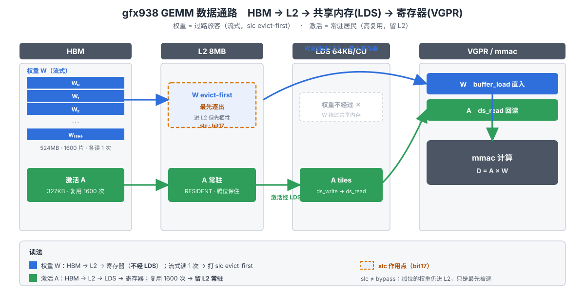

# 07 · 优化原理：为什么 slc 有效（硬件 + 指令）

> 一句话结论：decode GEMM 是带宽 bound，HBM 流量 = 一次性流过的权重 + 反复复用的激活 + 写回输出。
> 默认缓存策略下，大权重流把 L2 填满、把小激活逐出 → 激活每次复用都 miss 回 HBM，凭空多出一轮
> "激活流量"。slc（evict-first，`buffer_load` word0 bit17）告诉硬件"这批一次性数据缓存但优先
> 逐出"，把位置留给复用数据，bit-for-bit 无损。实测 bf16 gate_up 524MB M=32：-6.2%
> （422.4→396.3µs，1241→1323 GB/s，以 01/02 篇为准）。
>
> 本文讲这条因果链的两层（硬件 → 指令）；
> 数字全部以 01/02/03 篇已记录内容为准，不自造数字。

## 1. 硬件层：缓存层级与"污染"问题

### 1.0 优化背景：M=32/64 带宽利用率不足（slc 的动机）

**我们的背景**：decode 场景 GEMM 是带宽 bound，但 **M=32 / M=64 的实测带宽利用率只有
~60%**，距离 **~80% 的理想值还有明显差距**——说明 HBM 流量里有可以省掉的冗余字节，
存在优化空间。这正是 slc（evict-first）针对的问题：大权重流冲刷 L2、把小激活逐出，
造成激活复用时多余的 HBM 流量（详见 1.3）。

### 1.1 gfx938（CDNA3）缓存链

| 层级 | 容量 | 管理方式 |
|------|------|----------|
| HBM | 峰值 **1.8 TB/s** | 带宽墙，memory-bound 的天花板（01 篇） |
| L2 | **8 MB**（全 CU 共享） | 硬件自动缓存，受 cache hint（slc/glc）影响 |
| L1 / LDS | LDS **64 KB/CU**（显式管理）；L1 是 `buffer_load` 走的硬件缓存 | LDS 只够 1 WG/CU，split-K 无空间（01/02 篇） |

64 个 CU。decode 算术强度 ≈ 2·M FLOP/byte，roofline 交点 M_ridge ≈ 155（560TFLOPS÷1.8TB/s），
**M < 155 全部 memory-bound**（M=32 带宽墙天花板仅 ~115 TFLOPS）：优化方向是**搬得更快**，
不是算得更快（01 篇判据）。

### 1.2 小 M decode GEMM 的流量结构（以 bf16 gate_up M=32 为例）

- 权重 N×K = 51200×5120×2B = **524MB**：**streaming**，每个输出 tile 读一遍自己那块，读完不再读（一次性）。
- 激活 M×K = 32×5120×2B = **327KB**：**复用**，被全部 N-tile 反复读，工作集小。
- 输出 M×N 写一次，占比小。

**两个 operand 的组织形式**（为什么激活能常驻 L2、权重不能）：

两者在 HBM 里都是**一块连续的二维矩阵**，差别在**被读的粒度**和**复用次数**：

```
  权重 W  (K=5120 行 × N=51200 列)   激活 A  (M=32 行 × K=5120 列)
  ┌──┬──┬──┬────────┬──┐             ┌────────────────────────┐
  │W₀│W₁│W₂│   ⋯    │W₁₅₉₉│ 96×96 网格  │        A  (一整块)      │
  │  │  │  │        │     │            │   32 × 5120  = 327KB   │
  └──┼──┼──┼────────┼──┘             └────────────────────────┘
     │  │  │        │                 ▲  ▲  ▲  ▲  ▲
     │  │  │        │        被 1600 个 N-tile 各读 1 遍（同一整块 A）
  每个 N-tile 只读   自己那一列 320KB（5120×32），读完不再碰
```

| | 组织 | 被读粒度 | 复用次数 | 能否常驻 L2 |
|---|---|---|:---:|:---:|
| **权重 W** | 524MB 大矩阵，切成 1600 片 | 每 CTA 读**自己那片 320KB** | **1 次/片**（片间不复用） | ✗ 524MB ≫ 8MB，必流走 |
| **激活 A** | 327KB 一小块（一整块） | 每 CTA 读**整块 A** | **1600 次**（全 N-tile 同一块） | ✓ 327KB ≪ 8MB，放得下 |

**为什么激活可以常驻 L2**（两条都满足才成立）：
1. **容量够**：激活整块只有 327KB，L2 有 8MB —— 装得下约 24 份，一份绰绰有余；权重 524MB 是 L2 的 65 倍，根本装不下，只能流。
2. **复用高（时间局部性）**：1600 个 N-tile CTA **读的是同一块 327KB** —— 只要它第一次进 L2 后没被逐出，后面 1599 次全命中。而权重每片 320KB **只被 1 个 CTA 读、读完即弃**，留在 L2 纯属占地方。

→ 所以缓存里**该留的是激活（小 + 高复用）、该赶的是权重（大 + 零复用）**。slc 干的就是：给权重 load 打 evict-first，让 524MB 权重的流**冲刷时优先牺牲自己**，把 L2 位置留给那块反复读的激活（见 1.3 污染机制）。

**"权重恰好全局读一遍"的推导**（winner kernel `MT128x32x128`，tile-M=128 / tile-N=32）：
M=32 ≤ tile-M=128 → **只有 1 个 M-tile**；N=51200 ÷ tile-N=32 = **1600 个 N-tile**，
每个 N-tile 只读自己那片 32×5120 的权重 → **权重总量恰好被读 1 次（纯流式）**；
而激活 327KB 被 1600 个 N-tile **各读 1 遍（复用 1600 次）**。

### 1.3 关键不等式与污染机制

权重 524MB **≫** L2 8MB（必然流过、不可能常驻）；激活 327KB **≪** 8MB（理可常驻）。理想：激活常驻 L2，权重流过不留痕，HBM 总字节 ≈ 权重 + 激活(一次) + 输出。

实际（默认策略）：权重的流式 load **填充 L2 cache line**，524MB 流过 = 反复冲刷 8MB，把激活的
line **逐出** → 激活下次被别的 N-tile 读就 miss 回 HBM。HBM 总字节多出"激活 miss × 复用次数"
项。**量化上限**：激活若每次读都 miss → 额外 HBM 流量 = 1600 × 327KB ≈ **524MB ≈ 权重流量翻倍**
（最坏 HBM 总流量 2×权重）；slc 后激活大部分 hit → 回到 ≈1× 权重（理想）。
**实测只拿到 -6.2%（01/02 篇），小于理论上限**：clean 下 LRU 本来就留下部分激活命中，且 HBM
读取与计算时间重叠。**-6.2% 不是天花板，只是当前 LRU 行为下的实测值**，别拿它当上限。

### 1.4 为什么这是"无损"优化

缓存策略只决定数据**从哪一级来**（L2 命中还是回 HBM），不改变数据内容本身：改后 kernel 输出
与原始 **bit-exact**（bf16 slc verify norm_error=5.57e-5，属 bf16 正常误差，02 篇）。这是 slc
相对 Layout A（重排权重、须 serving 侧配对）的根本优势：**只改二进制里一个 bit，零正确性风险**。

### 1.5 数据通路图：谁过路、谁常驻（D = A × W）

同一个 mmac，喂它的两条 operand 路**结构不同**——这决定了"缓存里该留谁、该赶谁"。
先给结论表，再看图：

| 缓存层级 | **权重 W**（蓝，过路） | **激活 A**（绿，常驻） |
|:---:|:---|:---|
| HBM | 524MB · 1600 片 | 327KB · 一整块 |
| L2 (8MB) | 进，但标 **evict-first**（最先被逐） | **常驻**，腾位时保住 |
| LDS (64KB/CU) | **不经过 ✕** | 经（ds_write→ds_read） |
| VGPR → mmac | buffer_load 直入 | ds_read 回读 |
| 复用 | 每片读 **1 次** | 同一块读 **1600 次** |
| slc 位 | **打在它身上**（bit17） | 不打（要打就方向反了） |

**图**：权重(蓝)=过路旅客，激活(绿)=常驻居民，琥珀虚框=slc 作用点（复用次数推导见 1.2）。



**三个要点**：
1. **权重绕开 LDS**（"直达寄存器"是相对 LDS 而言的）——它 HBM→L2→VGPR 一路走，**中间仍过 L2/L1 硬件缓存**，只是不碰片上共享内存。
2. **slc 只落在权重这条**：给一次性大流数据打 evict-first；给高复用的激活打 = 亲手把它逐出，方向反了。
3. **slc ≠ bypass**：加位的权重**仍进 L2**（mmac 马上要读，短期复用要保），只是腾位时它先被牺牲，把位置让给那块反复读的激活（污染机制见 1.3）。

### 1.6 流程图：无 slc vs 有 slc（左右对照）

> **权重 = 过路旅客，激活 = 常驻居民；slc 是给旅客的"优先让座"标记，保证居民不被挤走。**

**精确点 1：slc 不是"不缓存"，是"缓存但最先被逐"（evict-first 优先级标记）。**
权重加了 slc 后**仍会进 L1/L2**（mmac 马上就要读，短期复用还是要的），只是 L2 腾位置时
权重行**优先被牺牲**。真正"不进 L1"的是 **GLC 位（bit16）**，本项目**没用它**——
不要把 slc 理解成 cache bypass。

**精确点 2：权重"全局恰好读一遍"是推导出来的**（见 1.2）：M=32 ≤ tile-M=128 → 1 个 M-tile；
1600 个 N-tile 各读自己那片权重 → 权重纯流式 1 次；激活被 1600 个 N-tile 各读 1 遍（复用 1600 次）。

```
 数据角色        流量特征                无 slc (clean)                     slc 加在权重 load 上
 ─────────────  ──────────────────      ──────────────────────────────     ──────────────────────────────
 权重 524MB     全局读 1 次              HBM ──> L2/L1 ──> VGPR ──> mmac     同左，但缓存行标记 EVICT-FIRST：
 (B-operand)    (1600 N-tile 各读一片)   L2 被权重行持续填充，                        权重行照常进 L2/L1（短期复用），
                    冲刷 8MB L2           激活行被权重行逐出 (LRU)                  但腾位置时权重行先被牺牲
 激活 327KB     被 1600 N-tile 各读 1 遍  N-tile #1:   HBM 读入 (首次 miss)      N-tile #1:   HBM 读入 (首次 miss)
 (A-operand)    (复用 1600 次)            N-tile #2:   L2 MISS (被权重逐出)       N-tile #2:   L2 HIT ← 短链路
                                       ...  大量回 HBM                            N-tile #3..1600: 基本 HIT
                                       最坏额外 1600×327KB≈524MB                激活常驻 L2，链路变短
                                       HBM 总流量 ≈ 2×权重                      HBM 总流量 ≈ 1×权重（回到理想）
```

**理论上限 vs 实测**：最坏 +524MB 冗余（2×权重）→ 理想 1×权重，理论空间是"把流量砍半"；
实测 bf16 M=32 只有 **-6.2%**（01/02 篇），差在：clean 下 LRU 已留下部分激活命中 + HBM 与
计算重叠。理论上限是分析工具，-6.2% 是这台硬件当前 LRU 行为下的实测值，**两者都别当"天花板"**。

## 2. 指令层：slc 位是什么

### 2.0 两个 operand 的路径不一样（slc 只落在权重这条上）

反汇编核实（`buffer_load` 直接进 VGPR，`ds_read_b128` 从 LDS 回读）。两条路只有"是否过 LDS"不同：

```
  HBM                L2/L1 (缓存)           LDS                VGPR           mmac
  ───                ────────────          ───                ──────         ─────
  权重 W ──buffer_load─┐                                              ┌──v_mmac
  (B-operand)          │◄ 过 L2/L1，但【不进 LDS】──────────────► v[96:127]
                        │
  激活 A ─buffer_load─► VGPR ─ds_write─► LDS ─ds_read_b128─► VGPR ─┘
  (A-operand)          (先落寄存器)   (显式中转)   (读回寄存器)
```

| | 路径 | 关键指令 | 过 L2? | 过 LDS? |
|---|---|---|:---:|:---:|
| **权重 W（B-operand）** | HBM → L2/L1 → VGPR → mmac | `buffer_load`(idxen) 直接进 VGPR | ✓ | ✗ |
| **激活 A（A-operand）** | HBM → VGPR → LDS → VGPR → mmac | `buffer_load` + `ds_write` + `ds_read_b128` | ✓ | ✓ |

三个要点（易错点）：
- **"权重直达寄存器" ≠ 绕过缓存**。权重路中间**仍过 L2/L1**（`buffer_load` 走的硬件缓存），只是不碰 LDS。
- **slc 只打在权重这条的 `buffer_load` 上**（它过 L2 那一级的 cache line），标 evict-first。
- 激活虽走 LDS，它的 L2 命中与否仍由 **LRU + 权重是否占位** 决定——slc 把 L2 让给激活。**给激活加 slc = 方向反**。

### 2.1 两个 cache hint 位：word0 bit 图

gfx900 系 `buffer_load` 指令 **word0** 的缓存策略位（本例只动 bit17，其余位原样不动）：

```
  word0  (32 bit)  —— 只画相关位，其余位（寻址/宽度/LDS 偏移）不碰
  ┌───────────────────────────┬────────────┬────────────────────┐
  │   ... 寻址 / 宽度 / 偏移 ... │  bit17     │   bit16  ...        │
  │                            │   SLC ★    │   GLC   ...         │
  └───────────────────────────┴────────────┴────────────────────┘
                                  │
                                  ▼
                      翻这一位 = word0 |= 0x20000

  SLC (bit17)  ★ 本项目用  evict-first：进缓存但【优先逐出】
  GLC (bit16)  本项目不用   L1 无效，只走 L2
```

| bit | 名字 | 语义 | 用没用 |
|-----|------|------|:---:|
| **17** | **SLC** | evict-first：缓存但优先逐出 | ★ 用 |
| 16 | GLC | L1 无效，只走 L2 | 不用 |

通用改法 `word0 |= 0x20000`，**只翻 bit17，不碰其他任何位**。策略位与寻址/宽度/LDS 偏移字段独立
→ 不影响数值、不影响指令流 → **bit-exact 无损**。

> ⚠ 反复强调：slc **不是** "不缓存/bypass"。加 slc 的权重**仍会进 L2/L1**（mmac 马上要读，短期
> 复用要保），只是腾位时权重行**先被牺牲**。真正 bypass L1 的是 GLC(bit16)，本项目不用。

### 2.2 两种指令形态都要会认（位同为 bit17，编码随指令变）

同一个 bit17，落在两种**不同编码形态**的 `buffer_load` 上，改法（哪个字节翻哪一位）不同：

| 形态 | 位置 | 特征 | 编码变化（word0） | 主战场 |
|------|------|------|----------|--------|
| **lds 型** | prologue | 直接写 LDS（`buffer_load_dwordx4 ... offen lds`） | `E05D1000 → E05F1000` | fp8 FusedMatmul |
| **idxen 型** | K-loop | 向量索引加载（`... idxen`） | `E05C3000 → E05E3000` | bf16 Tensile Cijk K-loop |

**"哪组 load 是流式读权重的大头"必须反汇编数清**——bf16 gate_up M=32 winner kernel
（`Custom_Cijk_..._MT128x32x128_SE_K1_thread384`）里：

```
  winner kernel 的 load 组（流式读 524MB 大权重）
  ┌────────────────────────────────────────────────────────────┐
  │  prologue:  8 条 lds 型  ──►  一次性、量小 ──► 影响小        │
  │                                                            │
  │  K-loop:    20 条 idxen 型 ──►  每轮读一片权重 ──► 主体 ★    │
  │                          slc 打在这里                       │
  └────────────────────────────────────────────────────────────┘
  → 只改 prologue（8 条 lds）= 改错组 = 收益趋零
```

区分权重 load vs 激活 load（只给**一次性大流数据（权重）**加 evict-first，**复用数据（激活）**
保持默认）：激活 load 有独立特征（0x8003xxxx / idxen **SET** / 不同 s-operand）。
给激活加 slc = 亲手把它逐出，**方向反了**。

### 2.3 与 C++ intrinsic 的对应（patch bit ≡ 改源码常量重编译）

`__builtin_hcu_buffer_load_dwordx4(Para1, ..., Para5)` 的 **Para4/Para5 = glc / slc 常量**，
都是**编译期常量**，直接折进 word0 的 bit16/bit17：

```
  源码路径                        二进制路径
  ────────                        ────────
  Para5 (slc常量) = true   ──►  编译器折进 word0 bit17
        │                               ▲
        │                               │  产物字节一致
        └───────────────────────────────┘
              patch word0 |= 0x20000
```

**patch 二进制 word0 bit17 ≡ 把源码 Para5 翻成 true 再重编译**，两者生成的指令字节完全一致。
"改 bit 无损"的另一角度：策略位不含数据依赖，只由常量决定"从哪一级取数"。改 bit16 即改 Para4(GLC)，
本项目不用。
